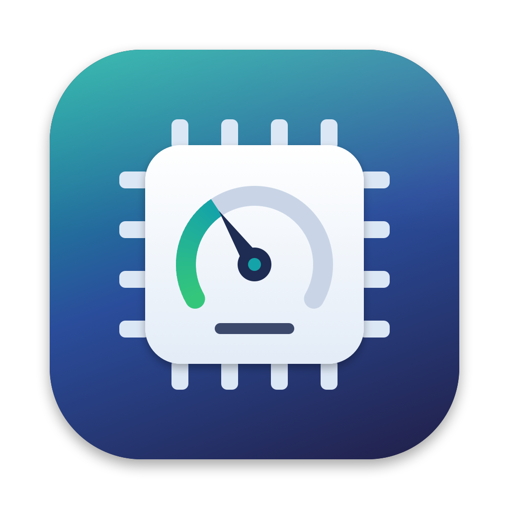
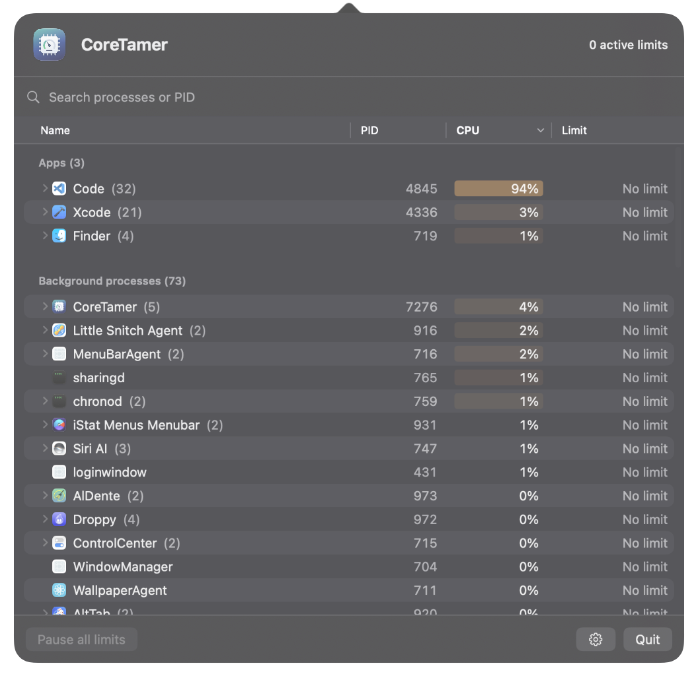

<p align="center">
  
</p>

<h1 align="center">CoreTamer</h1>

<p align="center">
  <b>Tame CPU-hungry apps right from your menu bar.</b><br>
  A native, universal macOS app that limits the CPU usage of individual processes.
</p>

<p align="center">
  <a href="https://github.com/vordenken/CoreTamer/releases/latest"></a>
  <a href="https://github.com/vordenken/CoreTamer/actions/workflows/build-release.yml"></a>
  <a href="LICENSE"></a>
  
  <a href="CONTRIBUTING.md"></a>
</p>

<p align="center">
  
</p>

## ✨ Features

- 🐢 **Limit CPU per process or app group** — one shared budget for an app and its helpers, or just its main process; 100% equals one CPU core
- 💻 **Universal** — runs natively on Apple Silicon and Intel Macs, no Rosetta needed
- 🔍 **Search & sort** — find processes by name or PID, sort by clicking the *Name*, *PID*, *CPU* or *Limit* column header
- 🗂️ **Grouped like Task Manager** — apps, background processes and system processes in separate sections; an app's helper processes fold under it with their combined CPU
- 🌡️ **Readable at a glance** — native table with column headers, alternating rows and a subtle CPU heat map
- ⏸️ **Pause & resume** — suspend all limits with one click
- 🔁 **Restore limits** — optionally re-apply limits when an app is relaunched
- 🚀 **Launch at login** — via macOS's built-in login items
- 🔄 **Automatic updates** — via Sparkle, with optional automatic downloads and beta versions;
  background updates get a gentle menu bar reminder
- 🛟 **Safe by design** — a watchdog resumes throttled processes if CoreTamer or a controller quits unexpectedly
- 🔒 **No special permissions** — no admin rights, Accessibility or Screen Recording access required

## 🚀 Quick Start

1. Download `CoreTamer.dmg` from the [latest release](https://github.com/vordenken/CoreTamer/releases/latest)
2. Open the disk image and drag **CoreTamer.app** to your Applications folder
3. Open CoreTamer — it lives in your **menu bar** (no Dock icon)
4. Select a process, enter a CPU limit and click **Apply**. On an app row, choose **Entire app** to share the limit with its helpers, or **Main process only** to limit its main PID.

> [!WARNING]
> CoreTamer is not notarized by Apple, so macOS may block both the disk image and the app.
> To open it anyway:
>
> 1. Try to open the disk image or CoreTamer once and close the warning
> 2. Open **System Settings → Privacy & Security**
> 3. Scroll down and click **Open Anyway** next to the CoreTamer message
> 4. Confirm with your password or Touch ID
> 5. Repeat for the app after copying it to Applications if macOS blocks it again
>
> Please do not disable Gatekeeper globally.

### Good to know

- Only your own processes can be limited; system and other users' processes are read-only.
- Individual processes show their name and PID without a scope selector. On an app row,
  **Main process only** (default) limits the main PID. **Entire app**
  counts the CPU time of the app and all its grouped helpers together: 50% means
  50% total, not 50% per helper. The whole group is suspended/resumed together.
- A helper's **Select … app group** link selects its owning app without applying a limit.
  Helpers covered by a shared app budget show that budget instead of individual limit controls.
- New helpers join on the next process refresh (1–5 seconds, including when display updates
  are paused); exited helpers leave automatically. Unattributable processes cannot be included.
  Protected, foreign or externally stopped helpers are skipped and keep showing their own state.
- Group and individual limits cannot overlap. Remove the shared app limit before applying an
  individual helper limit, or remove existing helper limits before enabling a shared budget.
- Clicking the selected row again clears the selection and closes the inspector. Disclosure
  triangles still expand/collapse helpers; column headers still sort.
- Limits are averages: very low limits can make an app stutter visibly.
- Sections: **Apps** have a Dock icon; **Background processes** are your menu bar apps, agents
  and helpers without an app; **System & other users** are read-only. Sorting applies within
  each section, so rows never jump between sections.
- Helpers are folded under the app macOS holds responsible for them, as Activity Monitor does
  (for example Safari's WebKit content processes under Safari). Otherwise they join the app
  whose bundle contains them or that launched them (for example a shell under Terminal).
  This also applies when macOS lists an XPC helper as a separate background application.
  The app row shows combined CPU; a shared limit is labelled **total**, and covered helpers
  show **Shared**. Without a shared budget, helpers remain individually limitable.
- CPU readings use exponential smoothing (five-second time constant) and whole percents.
  The update speed can be Fast (1 s), Normal (2 s, default), Slow (5 s) or Paused; limits keep
  working while the display is paused.
- Optionally, the list can pause updates (values and order) while you point at it; limits keep running (off by default).
- The gear button holds these display options plus background processes, grouping by type,
  restore and launch at login. The limit inspector is hidden while settings are open; closing
  settings shows the current selection again.
- On first launch, CoreTamer opens its window with a short welcome that offers launch at login
  and automatic update checks (on by default); afterwards it lives in the menu bar.
- The interface follows the language selected for CoreTamer in macOS System Settings. English
  and German are supported; English is used when macOS selects an unsupported language.
- Don't run another CPU limiter on the same process.

## 💻 Requirements

- macOS 14 (Sonoma) or later
- Apple Silicon or Intel Mac

## 🔨 Building & Releasing

Open `CoreTamer.xcodeproj` in Xcode, select the **CoreTamer** scheme and press **Run** (⌘R).
For a universal release build:

```bash
bash scripts/build.sh
open dist/CoreTamer.app
```

See [BUILD.md](BUILD.md) for build requirements, tests and the release process.

## ⚙️ How It Works

CoreTamer measures each process's CPU time with `libproc` and throttles it by
briefly suspending and resuming it (`SIGSTOP`/`SIGCONT`, sampled every 10 ms).
Each limit runs in its own small controller with a watchdog. For a shared budget the controller
sums the members' raw CPU-time deltas; display smoothing does not affect enforcement. Membership
updates are sent over the app/controller pipe, independently of display pause. If CoreTamer quits
or a controller is stopped, all targets it suspended are resumed. Process ID,
owner and start time are verified before every signal, and critical system
processes are protected.

## 🤝 Contributing

Contributions are welcome! Please read the [contributing guidelines](CONTRIBUTING.md)
and check the [security policy](SECURITY.md) before reporting vulnerabilities.

## ❤️ Support

If you find CoreTamer useful, consider supporting its development:

<a href="https://www.buymeacoffee.com/vordenken"></a>
<a href="https://ko-fi.com/vordenken"></a>

## 📝 License & Privacy

CoreTamer is licensed under the [GNU General Public License v3.0](LICENSE).
Copyright © 2026 vordenken.

CoreTamer collects no data; its only network access is the update check via Sparkle. See the [privacy policy](PRIVACY.md).

## 🙏 Acknowledgments

Inspired by [AppPolice](https://github.com/AppPolice/AppPolice), the classic Intel-only CPU limiter for macOS.
CoreTamer is an independent implementation in Swift and C and contains no code or artwork from it.
Updates via [Sparkle](https://sparkle-project.org).

---

<p align="center">Created by <a href="https://github.com/vordenken">vordenken</a></p>
